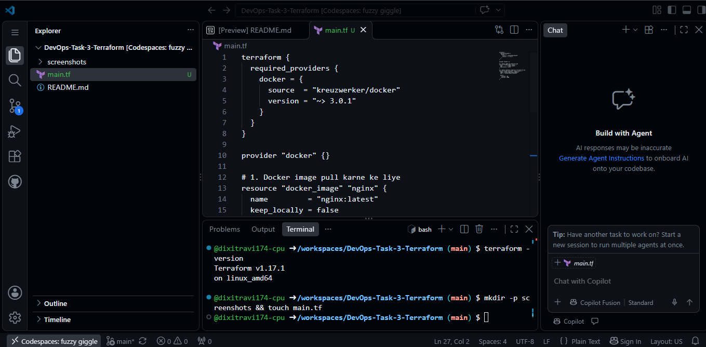
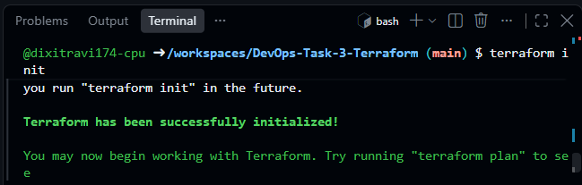
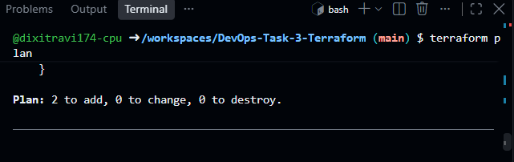
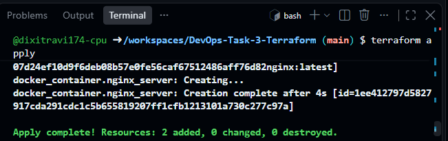
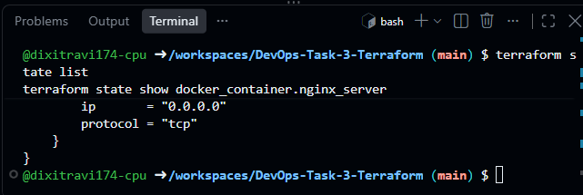
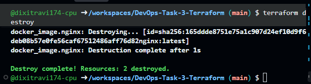

# TASK 3: Infrastructure as Code (IaC) with Terraform

## 📌 Project Overview
This repository contains the implementation of **Task 3: Infrastructure as Code (IaC) with Terraform** for the Elevate Labs DevOps Internship. The objective is to provision, manage, and destroy a local Docker container (Nginx) using HashiCorp Terraform.

---

## 🛠️ Tech Stack & Tools
- **IaC Tool:** HashiCorp Terraform (v1.17+)
- **Containerization:** Docker Engine
- **Cloud Dev Environment:** GitHub Codespaces (Linux amd64)
- **Version Control:** Git & GitHub

---

## 📁 Repository Structure
DevOps-Task-3-Terraform/
├── main.tf                 # Terraform configuration for Docker provider & resources
├── .terraform.lock.hcl     # Provider dependency lock file
├── README.md               # Project documentation & interview answers
└── screenshots/            # Step-by-step execution logs & outputs
    ├── 01-main-tf.png
    ├── 02-terraform-init.png
    ├── 03-terraform-plan.png
    ├── 04-terraform-apply.png
    ├── 05-terraform-state.png
    └── 06-terraform-destroy.png

---

## 🚀 Execution Steps & Verification

### 1. Terraform Configuration (`main.tf`)
Defined the `kreuzwerker/docker` provider, pulled the latest `nginx` image, and configured an Nginx container exposing port `8080:80`.

### 2. Initialization (`terraform init`)
Initialized the backend and downloaded the required Docker provider plugin.

### 3. Execution Plan (`terraform plan`)
Created an execution plan to preview resource additions before provisioning.

### 4. Infrastructure Provisioning (`terraform apply`)
Executed the deployment plan to provision and run the Docker container.

### 5. Inspecting Terraform State (`terraform state`)
Verified tracked state attributes and managed resources.

### 6. Clean-up & Destruction (`terraform destroy`)
Safely tore down and removed all managed infrastructure.

---

## 📚 Interview Questions & Answers

### 1. What is IaC?
**Infrastructure as Code (IaC)** is the practice of provisioning and managing computing infrastructure (servers, networks, containers) using machine-readable configuration files rather than physical hardware configuration or interactive manual tools. It ensures repeatability, consistency, and version control.

### 2. How does Terraform work?
Terraform uses a declarative model where you define the desired target state in HashiCorp Configuration Language (HCL). It operates via a 3-phase workflow:
1. **Core:** Analyzes configurations, dependencies, and state files.
2. **Providers:** Translates API calls to cloud/local platforms (AWS, Azure, Docker).
3. **Execution Plan:** Calculates the difference between desired state and actual infrastructure to make exact changes.

### 3. What is a Terraform state file?
The state file (`terraform.tfstate`) is Terraform's single source of truth. It records metadata, resource mappings, and dependencies that link configuration code to real-world provisioned resources.

### 4. Difference between `terraform plan` and `terraform apply`?
- **`terraform plan`:** A read-only dry run that shows what actions Terraform will perform without altering real resources.
- **`terraform apply`:** Executes the planned actions to create, update, or delete actual infrastructure resources.

### 5. What are Terraform providers?
Providers are plugins that implement resource types and interact with upstream APIs (e.g., AWS, GCP, Docker, Kubernetes). They enable Terraform to speak the API language of the target platform.

### 6. What is resource dependency?
Resource dependency defines the order in which resources must be created or destroyed:
- **Implicit Dependency:** Automatically inferred when one resource references an attribute of another (e.g., `image = docker_image.nginx.image_id`).
- **Explicit Dependency:** Manually defined using the `depends_on` meta-argument.

### 7. How do you handle secret variables in Terraform?
- Never hardcode secrets in `.tf` files.
- Declare variables with `sensitive = true` to prevent them from showing up in console logs.
- Supply secrets at runtime using environment variables (`TF_VAR_variable_name`) or `.tfvars` files added to `.gitignore`.
- Store secrets securely in dedicated vaults (HashiCorp Vault, AWS Secrets Manager) and retrieve them via data sources.

### 8. Explain the benefits of Terraform.
- **Declarative Syntax:** Write what you want, Terraform figures out how to build it.
- **Platform Agnostic:** Manages multi-cloud, hybrid, and local container environments with a single tool.
- **Drift Detection & State Management:** Tracks real infrastructure changes and prevents configuration drift.
- **Modularity & Reusability:** Facilitates team collaboration and reusable architectural templates.